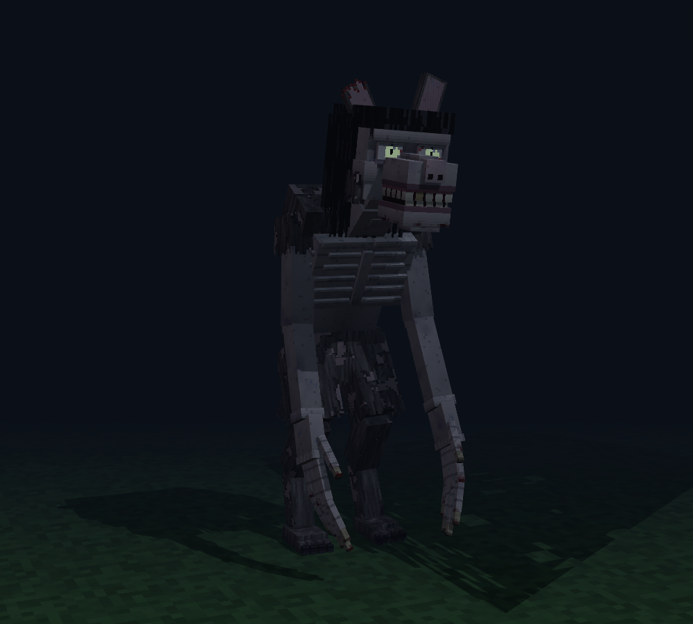
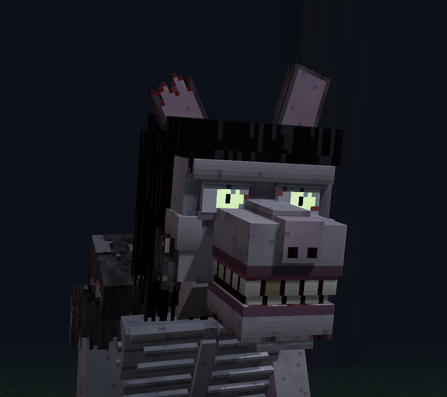
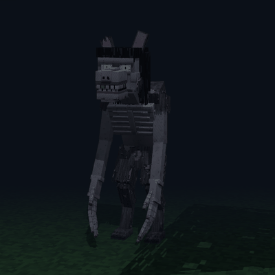
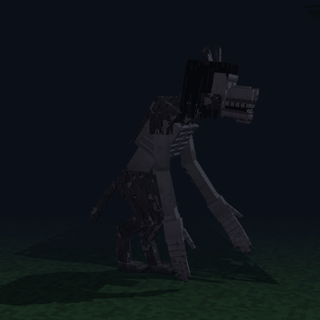
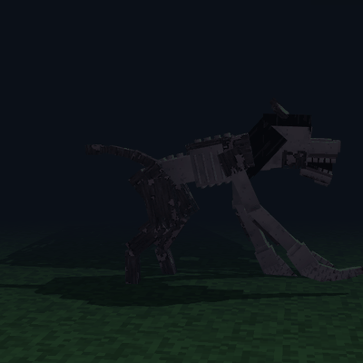
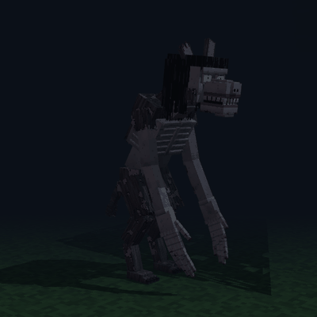
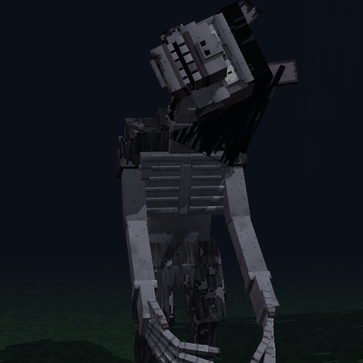
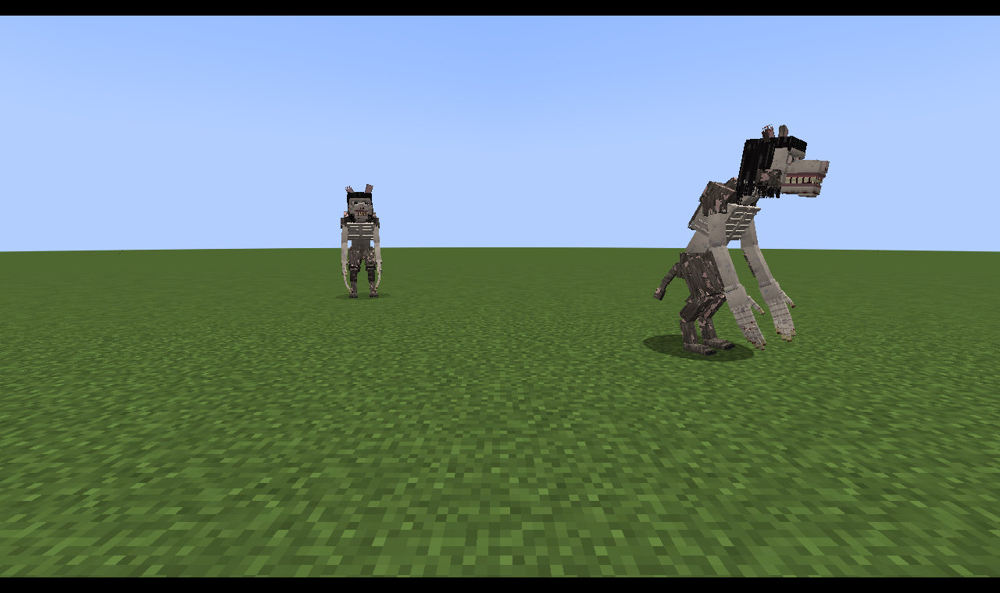
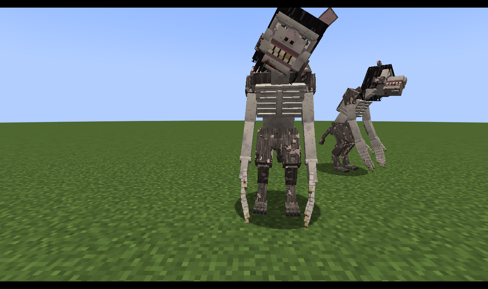

# Uncanny Werewolf — Fabric 1.20.1 + GeckoLib

Оборотень в стиле «зловещей долины»: истощённое тело с торчащими рёбрами, слишком длинные
руки с человеческими пальцами до земли, бледное человеческое лицо на волчьем черепе,
широкая улыбка из плоских *человеческих* зубов, светящиеся человеческие глаза с
точечными зрачками, длинные сальные волосы и облезлый мех.

 

## Поведение
* **Когда игрок смотрит на него** — замирает, выпрямляется, шея удлиняется, голова
  заваливается набок почти на 70°, пальцы перебирают воздух (`stare`).
* Если смотреть дольше 6 секунд — срывается и атакует. Снова «замереть» сможет только
  после того, как вы отведёте взгляд хотя бы на 3 секунды.
* Пока вы не смотрите — бежит на четвереньках (`run`), руки становятся передними лапами.
* Атака: челюсть «выламывается» на 75°, удар двумя руками (`attack`).
* Звуки: искажённо повторяет голоса жителей (низкий питч), рычит, воет при смерти.
* Спавнится ночью в лесах и тайге, есть яйцо призыва.

| idle | walk | run | attack | stare |
|---|---|---|---|---|
|  |  |  |  |  |

В игре (скриншоты реального клиента 1.20.1):

 

## Ассеты
Модель, анимации и текстуры генерируются скриптом `tools/generate_werewolf.py`
(49 костей, 145 кубов, текстура 1024×256 — 4 px на юнит, per-face UV):

```
pip install pillow numpy
python3 tools/generate_werewolf.py
```

Результат лежит в `src/main/resources/assets/uncanny_werewolf/` (`geo/`, `animations/`,
`textures/` + `werewolf_glowmask.png` для свечения глаз). Файлы открываются в Blockbench
(GeckoLib Animated Model).

Проверка геометрии (z-fighting, «плавающие» торцы у рваных кубов, перекрытия UV) в позе покоя
и в каждом кадре всех анимаций: `python3 tools/check_mesh.py` (код возврата 1 при проблемах).

## Сборка и запуск
```
./gradlew build        # jar в build/libs; тесты грузят ассеты загрузчиками GeckoLib
./gradlew runClient
```
Нужны Fabric API и GeckoLib 4.x для 1.20.1.

## Просмотр без Minecraft
```
python3 -m http.server 8765   # из корня репозитория
# открыть http://localhost:8765/preview/index.html
```
Просмотрщик на three.js использует те же конвенции осей и вращений, что GeckoLib и Blockbench.
GIF пересобираются через `preview/capture.mjs` (puppeteer-core) и `preview/make_gifs.py`.
